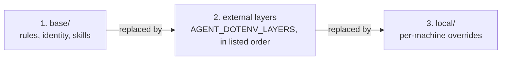
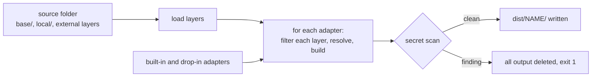

# agent-dotenv

Write your agent rules, identity and skills once. Build them for any coding agent: AGENTS.md, Claude Code, Cursor and more. Layered, secret-safe, standard library only.

`dotenv` keeps configuration in one file and loads it into any program. `agent-dotenv` does the same for agent setup: you keep rules, identity and skills in one portable folder, and the tool builds the files that each coding agent reads.

- **One source, many agents.** Each agent gets its own output from the same folder.
- **Layered.** Content from an employer, client or team lives in a separate layer. Remove the layer and only that content goes away.
- **Secret-safe.** Files marked `sensitive` never reach an output. Every output is scanned for secrets before it is kept.
- **Small.** Python 3.9 or newer, standard library only. A build uses no network and writes only under `dist/`.

## Install

You need Python 3.9 or newer. There is no PyPI release in v1.

```bash
pipx install git+https://github.com/suryast/agent-dotenv
```

This installs the `agent-dotenv` command. From a checkout you can run `python3 -m agent_dotenv` instead.

## Quickstart

Make a source folder. This is your own folder, separate from this repository. A private repository works well.

```bash
mkdir ~/my-agent-env && cd ~/my-agent-env
```

Create the starter files.

```bash
agent-dotenv init
```

```text
created ~/my-agent-env/base/rules.md
created ~/my-agent-env/base/identity.md
created ~/my-agent-env/local/paths.env.example
created ~/my-agent-env/secrets.ref
created ~/my-agent-env/.gitignore
created ~/my-agent-env/local/paths.env
next: edit the files in ~/my-agent-env
then run: agent-dotenv build --source ~/my-agent-env
then run: agent-dotenv doctor --source ~/my-agent-env
```

Edit `base/rules.md` and `base/identity.md`. Keep the lines between the `---` fences. For example, `base/rules.md`:

```markdown
---
scope: personal
---
# Rules

- Write short, direct answers.
- Ask before deleting files.
- Run the tests before you say a change is done.
```

Build every adapter.

```bash
agent-dotenv build
```

```text
built agents-md: 1 file(s) in ~/my-agent-env/dist/agents-md
built claude-ai-project: 1 file(s) in ~/my-agent-env/dist/claude-ai-project
built claude-code: 8 file(s) in ~/my-agent-env/dist/claude-code
built cursor: 2 file(s) in ~/my-agent-env/dist/cursor
```

Read the result.

```bash
cat dist/agents-md/AGENTS.md
```

```markdown
# Rules

- Write short, direct answers.
- Ask before deleting files.
- Run the tests before you say a change is done.

# Identity

- I am a backend developer. I work mostly in Python.
```

Copy `dist/agents-md/AGENTS.md` into a project and any tool that reads `AGENTS.md` uses it. Check the environment at any time with `agent-dotenv doctor`.

## Use the output

Each adapter writes to `dist/<adapter>/` inside your source folder.

| Agent | Output | How to use it |
|---|---|---|
| Any tool that reads `AGENTS.md` | `dist/agents-md/AGENTS.md`, plus `skills/<name>/SKILL.md` copies | Copy the files into a project. |
| Claude Code | `dist/claude-code/`, a plugin | `claude --plugin-dir dist/claude-code` |
| Cursor | `dist/cursor/.cursor/rules/*.mdc` | Copy the `.cursor` folder into a project. |
| claude.ai project | `dist/claude-ai-project/project-instructions.md` and `docs/` | Paste the instructions into the project and upload `docs/`. |

## Source folder

```text
my-agent-env/
  base/                 rules.md, identity.md, skills/<name>/SKILL.md, any other .md
  local/
    paths.env.example   committed
    paths.env           ignored by git
  adapters/             optional drop-in adapters (*.py)
  secrets.ref           names and where each value lives, never values
  dist/                 build output, ignored by git
```

Every Markdown file starts with frontmatter:

```text
---
scope: personal | external | sensitive    required
mode: replace | append                     default replace
targets: [agents-md, cursor]               default: all adapters
description: one line                      used in indexes
---
```

- `personal`: your own content. Any adapter may use it.
- `external`: content that belongs to another party, such as an employer, client or team. Only adapters that accept external content receive it.
- `sensitive`: never written to any output.

Files under `skills/` use the skill format and have no `scope`.

## Layers

Three kinds of layer are merged. A later layer replaces an earlier one, file by file, by relative path.



- `mode: append` adds the later body after the earlier body, separated by a blank line.
- External layers are folders outside the source folder. Set `AGENT_DOTENV_LAYERS` to a list of absolute paths separated by `:`, in the process environment or in `local/paths.env`. An empty value in the process environment falls through to `local/paths.env`.
- Only `base/` and `local/` hold skills. A `skills/` folder in an external layer is ignored with a warning.
- Each layer is filtered before the layers merge. A dropped file never leaks into a later file through `mode: append`. A dropped override falls back to the earlier file.

`agent-dotenv init --layer /absolute/path/to/layer` creates an external layer from a headings-only template and records it in `local/paths.env`.

## How a build works



An adapter returns data and does not write files. The core scans that data, deletes the old `dist/NAME/` and writes the new files. See [docs/security.md](docs/security.md) for what the scan catches and what it does not.

## Adapters

| Adapter | Writes | External content |
|---|---|---|
| `agents-md` | `AGENTS.md` (rules, then identity) and `skills/<name>/SKILL.md` copies | No. Refused, because `AGENTS.md` is meant to be committed to project repositories. |
| `claude-code` | A Claude Code plugin: manifest, skills, a session-start hook and a bundled loader | Index only. The hook prints one `path: description` line for each external file at session start. The plugin holds no external body text. |
| `cursor` | `.cursor/rules/agent-dotenv-rules.mdc` and `agent-dotenv-identity.mdc`, both `alwaysApply: true` | No. Refused, because Cursor rule files are committed to project repositories. |
| `claude-ai-project` | `project-instructions.md` and `docs/` for upload. It warns above 8,000 characters (`--instructions-limit N`). | Yes. External files are written to `docs/` as full bodies. |

Behaviour to know about:

- In `claude-ai-project`, an external layer file named `rules.md` replaces the base rules in the instructions, and it is also written to `docs/rules.md`. Layers replace by relative path.
- The Claude Code plugin version is the tool version. After a rebuild with new content, an installed copy may not refresh. Reload the plugin or reinstall it.
- A drop-in adapter runs as ordinary Python with your permissions. It loads only from `<source>/adapters/`. See [docs/adapters.md](docs/adapters.md).

## Commands

| Command | What it does |
|---|---|
| `agent-dotenv init [--source DIR] [--layer DIR]` | Creates the starter files. It never overwrites a file. `--layer` needs an absolute path to an empty or new folder. |
| `agent-dotenv build [--target NAME ...] [--source DIR] [--instructions-limit N]` | Builds the named adapters, or all of them. `--source` defaults to `AGENT_DOTENV_HOME`, then the current directory. |
| `agent-dotenv doctor [--source DIR]` | Checks `local/paths.env`, external layer paths, the Python version, the names in `secrets.ref`, drop-in adapters and whether `dist/` is newer than the sources. It exits 1 on any failure. |

## Documentation

- [docs/adapters.md](docs/adapters.md): write your own adapter, with the `BuildContext` reference and a worked example.
- [docs/security.md](docs/security.md): scopes, the secret scan and its limits, and what is never written.
- [examples/minimal/](examples/minimal/): a small source folder with one drop-in adapter.

## Development

```bash
python3 -m pytest -q
```

See [CLAUDE.md](CLAUDE.md) for the layout and the rules for contributors.

## Licence

[MIT](LICENSE)
