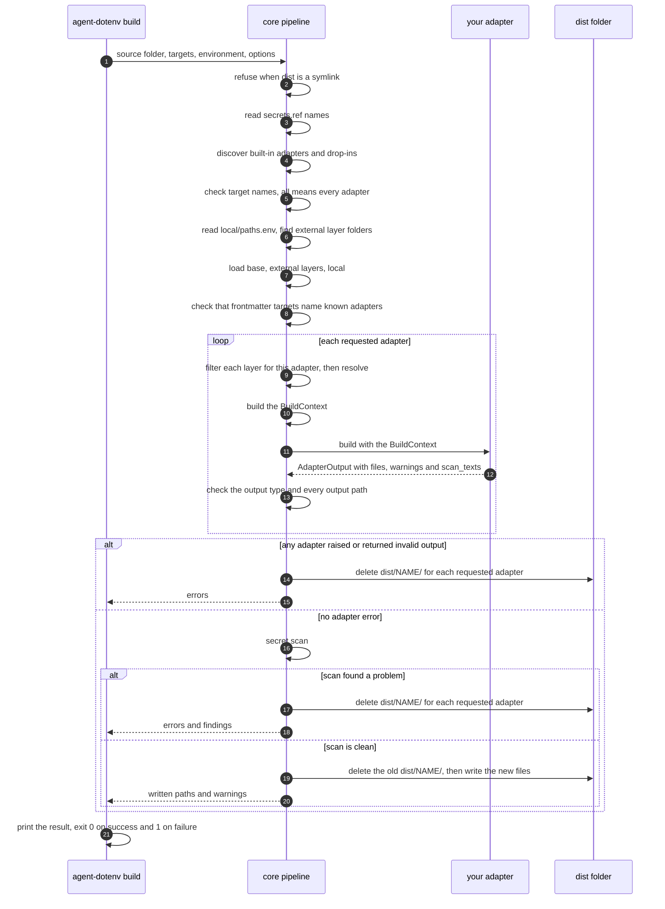

# Write an adapter

An adapter turns the resolved content of a source folder into the files that one agent reads. Four adapters are built in (`agents-md`, `claude-code`, `cursor`, `claude-ai-project`). You can add your own as a drop-in file.

## The interface

An adapter is a Python module with three names.

```python
NAME = "my-harness"            # used by --target and by `targets:` in frontmatter
ACCEPTS_EXTERNAL = False       # True lets the adapter receive scope: external files

def build(ctx):                # returns an AdapterOutput
    ...
```

- `NAME` is a string that matches `^[a-z][a-z0-9-]*$`. It must not clash with a built-in adapter or another drop-in.
- `ACCEPTS_EXTERNAL` is a bool. It is `False` when the output is committed to a project repository.
- `build(ctx)` takes a `BuildContext` and returns an `AdapterOutput`.

## A drop-in in 14 lines

Save this as `<source>/adapters/plain_text.py`. It is the adapter in [examples/minimal/](../examples/minimal/).

```python
"""A drop-in adapter: write the rules as one plain text file."""
from __future__ import annotations

from agent_dotenv.adapters_api import AdapterOutput, BuildContext

NAME = "plain-text"
ACCEPTS_EXTERNAL = False


def build(ctx: BuildContext) -> AdapterOutput:
    rules = ctx.sources.get("rules.md")
    if rules is None:
        return AdapterOutput(files={}, warnings=["rules.md is missing, so nothing was written"])
    return AdapterOutput(files={"notes.txt": rules.body.strip() + "\n"})
```

Build it from the source folder.

```bash
agent-dotenv build --target plain-text
```

```text
built plain-text: 1 file(s) in ~/my-agent-env/dist/plain-text
```

The file is `dist/plain-text/notes.txt`. If you changed a source since the last full build, `agent-dotenv doctor` now fails with "dist/ is older than the sources" for the other adapters until you run a full `build`. A frontmatter line `targets: [plain-text]` now limits a file to this adapter. `agent-dotenv doctor` lists every drop-in by path.

## BuildContext

`BuildContext` is a frozen dataclass. The core filters each layer for your adapter before it builds the context.

| Field | Type | Meaning |
|---|---|---|
| `sources` | `Mapping[str, Source]` | The resolved, filtered Markdown files, keyed by path relative to the layer root (for example `rules.md` or `people/a.md`). |
| `skills` | `Mapping[str, Skill]` | The resolved skills, keyed by skill name. Only `base/` and `local/` hold skills. |
| `external_index` | `Mapping[str, Source]` | The files whose winning copy comes from an external layer. It is empty when no external layer is active or when `ACCEPTS_EXTERNAL` is `False`. |
| `external_roots` | `tuple[Path, ...]` | The absolute paths of the active external layers. The core passes them to every adapter. |
| `local_values` | `Mapping[str, str]` | `DEVICE_NAME` and `VAULT_PATH`, when set. The process environment wins over `local/paths.env`. Other keys are not passed. |
| `source_dir` | `Path` | The absolute path of the source folder. |
| `options` | `Mapping[str, str]` | Adapter options from the command line. Today the only key is `instructions_limit`, set by `--instructions-limit`. |

The data types:

| Type | Fields |
|---|---|
| `Source` | `key` (relative path), `meta`, `body` (text after the frontmatter), `layer` (`base`, `external` or `local`) |
| `Meta` | `scope`, `mode`, `targets` (`None` means all adapters), `description` |
| `Skill` | `name`, `files` (`dict` of relative path to `bytes`), `layer` |

Import them from `agent_dotenv.adapters_api` (`BuildContext`, `AdapterOutput`), `agent_dotenv.layers` (`Source`, `Skill`) and `agent_dotenv.frontmatter` (`Meta`).

## AdapterOutput

| Field | Type | Meaning |
|---|---|---|
| `files` | `dict[str, str \| bytes]` | Output files. The key is a path relative to `dist/<NAME>/`. |
| `warnings` | `list[str]` | Messages for the user. The build prints each one as `warning: <NAME>: <text>` and still succeeds. |
| `scan_texts` | `dict[str, str]` | Text that is not in `files` but that the agent will see. The secret scan covers it. |

The core checks the output before it writes anything. A bad path, a wrong type or a duplicate path fails the build.

## One build run

The diagram shows the order of one `agent-dotenv build` run, and where your adapter's `build` is called.



Any step before the adapters run can also fail the build. See [security.md](security.md) for which folders a failed build deletes.

## Rules

1. **Return data. Do not write files.** The core deletes `dist/<NAME>/` and writes the files you return. This guarantees that stale output cannot remain and that the scan covers everything.
2. **Use relative paths.** A path must not be absolute, empty or contain `..`, a backslash or a NUL character. Use `/` as the separator.
3. **List run-time text in `scan_texts`.** If your output is a program that renders text later (for example a session hook), render the same text at build time and put it in `scan_texts`. The scan then covers it.
4. **Read only what `ctx` names.** Use the data in `ctx`. Read other files only from the directories that `ctx` names (`source_dir`, `external_roots`) or from your own bundled resources.
5. **Respect `ACCEPTS_EXTERNAL`.** If it is `False`, do not read `external_roots`. The core passes the paths to every adapter, so this rule is yours to keep.
6. **Do not print secret values.** Error and warning text is redacted by the core, but do not rely on it.
7. **Raise only for real failures.** If `build` raises, the whole run fails, the error names your adapter, and the core deletes the output of every adapter requested in that run.

## Where adapters load from

- Built-in adapters come from the `agent_dotenv.adapters` package.
- Drop-ins come from `<source>/adapters/*.py`. A file that starts with `_` is skipped.
- Adapters never load from external layers.
- A drop-in runs as ordinary Python with your permissions. Read a drop-in before you build a source folder that you did not write. See [security.md](security.md).

A file with a missing `NAME`, `ACCEPTS_EXTERNAL` or `build`, a bad `NAME`, an import error, or a name that is already used fails the build with the file path in the message.
