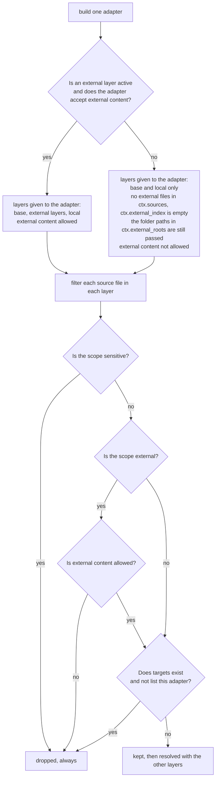
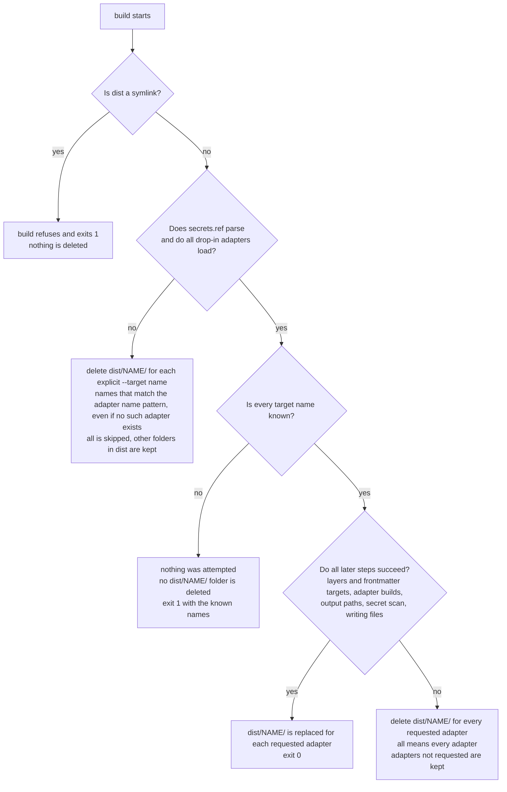

# Security notes

`agent-dotenv` builds files that you may commit, share or upload. These notes say what it keeps out of them, how it checks, and where the checks stop.

## Scopes

Every Markdown file has a `scope` in its frontmatter. The build fails if it is missing. Files under `skills/` have no scope.

| Scope | Meaning | Reaches an output |
|---|---|---|
| `personal` | Your own content. | Every adapter. |
| `external` | Content that belongs to another party, such as an employer, client or team. | Only when an external layer is active and the adapter sets `ACCEPTS_EXTERNAL = True`. |
| `sensitive` | Content that must never leave the source folder. | Never. The core drops it before any adapter runs. |

The core filters each layer for each adapter before the layers merge:

1. Drop every `sensitive` file.
2. Drop every `external` file unless an external layer is active and the adapter accepts external content.
3. Drop every file whose `targets` list does not name the adapter.

A dropped file cannot leak into a later file through `mode: append`. A dropped override falls back to the earlier file.

This diagram shows how the core decides, for one source file and one adapter, whether the file is kept.



## The filter rule per adapter

| Adapter | Accepts external | What it receives | Notes |
|---|---|---|---|
| `agents-md` | No | `personal` files and skills | The output is meant for project repositories, so it never holds external text. |
| `cursor` | No | `personal` files | Same reason. |
| `claude-code` | Index only | `personal` files and skills, plus external files for the index | The plugin holds no external body text. At session start the hook prints one `path: description` line for each external file. |
| `claude-ai-project` | Yes | `personal` files, plus external files as `docs/` bodies | The output is uploaded to a project. It is not meant for a repository. |

Skills are exempt from `scope`. Every file in a skill folder is copied to every adapter that writes skills (`agents-md` and `claude-code`). Do not put private text in a skill.

The `description` line of an external file is printed in the Claude Code session context. Do not put private text in it.

## The secret scan

The build scans every output before it keeps anything. It fails on:

- A GitHub token: `ghp_` followed by 36 letters or digits, or `github_pat_` followed by 20 or more letters, digits or `_`.
- A Slack token: `xoxb-`, `xoxa-`, `xoxp-`, `xoxr-` or `xoxs-`, followed by 10 or more letters, digits or `-`.
- An AWS access key id: `AKIA` followed by 16 capitals or digits.
- A key that starts with `sk-`, followed by 20 or more letters, digits, `_` or `-`. The character before `sk-` must not be a letter or digit, so `task-management-...` does not match.
- A private key header (`-----BEGIN ... PRIVATE KEY-----`).
- The literal value of any environment variable named in `secrets.ref`.

`secrets.ref` holds names, never values. Each line is `NAME=source`, where `source` is `env`, `keychain:<item>` or `op://<reference>`. A value shorter than 8 characters after trimming is ignored, because it would match ordinary text.

The scan covers every text file the adapters return and every text they list in `scan_texts`. It also covers the output file paths, including the paths of binary files, and the names in `scan_texts`. The build scans these names before it writes any file. A finding in an output file path is labelled `<adapter>/(output file names)`, and a finding in a `scan_texts` name is labelled `<adapter>/(scan text names)`. Its line is the position of the name in the sorted list of that adapter's names, so the finding never shows the name. A finding names the file and the line, and never the value:

```text
error: secret scan found 1 problem(s); no output was kept
agents-md/AGENTS.md:5 pattern:ghp
```

The kind is `pattern:<name>` or `secret-ref:<NAME>`. On a finding the build exits 1 and deletes the output of every adapter requested in that run.

`build` never prints a secret value. Error text, warning text and the file paths in findings are redacted: a `secrets.ref` value or a token in a path is shown as `[redacted]`.

### What the scan does not catch

- Secrets in other shapes: passwords, other vendors' keys, JSON web tokens, connection strings.
- A value shorter than 8 characters.
- A value that spans several lines. The scan reads one line at a time.
- An encoded, split or otherwise changed value.
- A secret in a binary file or in a file that is not valid UTF-8.
- A `secrets.ref` entry whose value is not in the environment of the `build` command. `build` reads values only from environment variables. `doctor` checks that a `keychain:` or `op://` item resolves, but `build` does not read it. To have the scan cover such a secret, export it under the same name when you build.
- Text that changes after the build. The Claude Code hook reads `local/` and the external layers at session start. The build scans what it renders at build time, not later edits.
- Anything a drop-in adapter does itself. See below.

The scan is a safety net. Keep secrets out of the source folder in the first place.

## What a failed build deletes

A failed build deletes `dist/<name>/` for every adapter requested in that run. With `all`, that is every adapter, once the adapters have loaded. It keeps the output of adapters that were not requested, and it keeps other folders in `dist/`.

When a target name is unknown, nothing is built and no output is deleted. The build exits 1 and lists the known names.

Known limit: if `secrets.ref` is invalid or a drop-in adapter does not load, the build cannot check the target names yet, so it deletes `dist/<name>/` for every `--target` name, and a mistyped name that equals a folder you made yourself in `dist/` deletes that folder.

This diagram shows what a failed build deletes, depending on how far the build got.



## What is never emitted

- Files with `scope: sensitive`, by any adapter, including drop-ins that read `ctx`.
- `secrets.ref`. No built-in adapter reads it for output.
- `local/paths.env`. The two values `DEVICE_NAME` and `VAULT_PATH` are the exception: the Claude Code session context prints them when set. The build scans that text.
- External body text in the `agents-md`, `cursor` and `claude-code` outputs.
- Anything outside `dist/`. A build never writes elsewhere. It refuses to run if `dist` is a symbolic link.

The built outputs do hold your own content. The Claude Code plugin contains your `personal` rules and identity in full, and `loader/home.txt` holds the absolute path of your source folder. Treat `dist/claude-code/` as private unless you have read it.

## Drop-in adapters are code

A drop-in adapter is a Python file in `<source>/adapters/`. It runs as ordinary Python with your permissions when you run `build` or `doctor`. It can read files, use the network and write anywhere. Nothing restricts it, and the secret scan does not cover what it does by itself. The core does not stop a drop-in from reading a `sensitive` file from disk.

- Read every drop-in before you build a source folder that you did not write.
- `doctor` prints a notice and lists each drop-in by path.
- Adapters load only from the built-in package and from `<source>/adapters/`. They never load from external layers, so an external layer cannot add code to your build.
- A drop-in that raises an error fails the build and deletes the output of that run.

## Reporting a problem

Open an issue on the repository. Do not include secret values in it.
